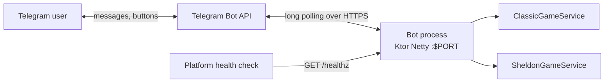
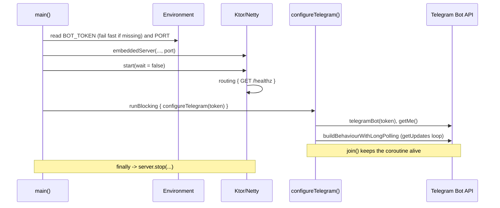
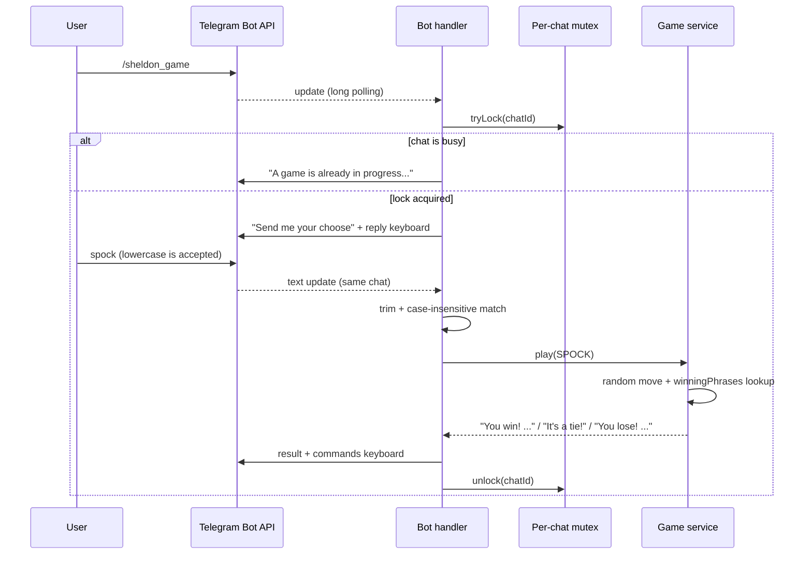
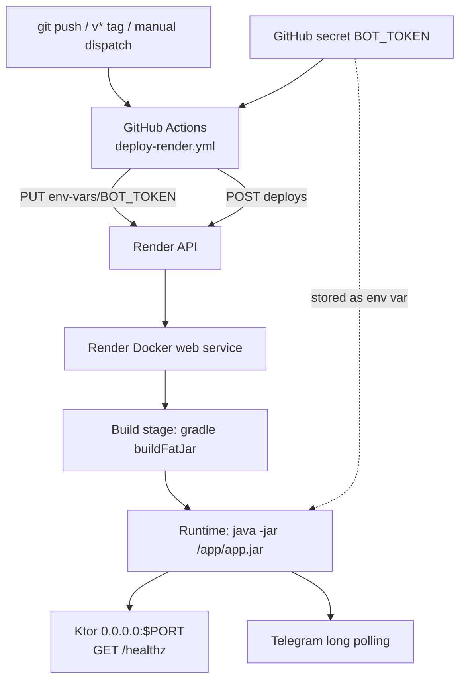

# Architecture

This document describes how the bot is put together, how a Telegram update travels
through the system, and where to extend it.

## Context



The bot is an outbound-only client of the Telegram Bot API. It does not expose a
webhook, so it can run behind NAT or on a PaaS without a public URL. It is deployed
to Render as a Docker web service; the Ktor server binds `0.0.0.0:$PORT` (Render
provides `PORT`, default 8080) and serves only `GET /healthz`.

## Components

| Component | File | Responsibility |
| --- | --- | --- |
| Entry point | `src/main/kotlin/com/el_giancar/Application.kt` | Reads `BOT_TOKEN` and `PORT`, starts `embeddedServer(Netty)`, installs `/healthz`, then runs the Telegram loop on the main thread. |
| Telegram plugin | `src/main/kotlin/com/el_giancar/plugins/Telegram.kt` | Reads `BOT_TOKEN`, creates the bot, registers commands, builds keyboards, parses input, serializes games per chat, runs long polling. |
| Move enums | `src/main/kotlin/com/el_giancar/model/ClassicMoveType.kt`, `SheldonMoveType.kt` | Allowed moves. |
| Game services | `src/main/kotlin/com/el_giancar/srv/ClassicGameService.kt`, `SheldonGameService.kt` | Choose a random computer move, resolve the round, return a message. Stateless and Telegram-free. |
| Tests | `src/test/kotlin/com/el_giancar/srv/*Test.kt` | Exhaustive pair tables and canonical phrase checks. |
| Logging | `src/main/resources/logback.xml` | Console appender; root level `info`. |
| API spec | `src/main/resources/openapi/documentation.yaml` | Description of `/healthz`; not referenced by code. |
| CI | `.github/workflows/ci.yml` | Builds and tests on push/PR. |
| Deploy | `.github/workflows/deploy-render.yml` | Updates `BOT_TOKEN` on Render and triggers a deploy. |

## Startup sequence



The HTTP server starts **before** the Telegram loop, so `/healthz` is reachable
while the bot is running. `runBlocking` keeps the main thread on the long-polling
task; if Telegram startup or polling fails, the exception propagates, the server is
stopped in `finally`, and the process exits non-zero. Ktor uses a `SupervisorJob`
for application children, which is why the bot is not launched as a fire-and-forget
child.

## Update flow



Key points:

- Command handlers are coroutines owned by tgbotapi's behaviour builder.
- `onCommand` runs the scenario in a subcontext filtered by `MessageFilterByChat`,
  so updates are already scoped to the originating chat. The game code adds an
  explicit `it.chat.id == message.chat.id` check as a second safety net.
- A `ConcurrentHashMap<Long, Mutex>` serializes games per chat. Different chats run
  independently.
- Input is trimmed and matched case-insensitively against the enum names. Invalid
  input gets a hint and up to `MAX_MOVE_ATTEMPTS` (3) tries; any command cancels the
  game. No state is persisted.

## Domain model

Two enums model legal moves:

```kotlin
enum class ClassicMoveType { PAPER, ROCK, SCISSORS }
enum class SheldonMoveType { PAPER, ROCK, SCISSORS, LIZARD, SPOCK }
```

The Telegram layer parses text into an enum value; the services only accept enums.
Button labels are the enum `name`s.

### Winner resolution

Both services hold a `winningPhrases` map keyed by `(winner, loser)`:

- `ClassicGameService`: 3 pairs.
- `SheldonGameService`: 10 pairs.

A round is resolved by looking up `(player, computer)` and `(computer, player)`:

- equal moves → tie;
- `(player, computer)` present → player wins with that phrase;
- `(computer, player)` present → computer wins with that phrase;
- anything else → `error(...)`, which indicates a missing rule.

Each service also exposes a deterministic `play(playerMove, computerMove)` overload.
This keeps tests free of randomness. The random overload picks with
`java.util.Random` (injectable via the constructor).

## Error handling

- Missing `BOT_TOKEN` fails at startup with an actionable message.
- Unknown moves are re-prompted (max 3 attempts), then the game is cancelled cleanly.
- Sending a command while a game is pending cancels the game and releases the lock.
- A second game in the same chat is rejected without disturbing the first.
- Telegram/network failures still propagate to the handler coroutine; there is no
  retry/backoff layer.

## Deployment

The bot is deployed to **Render** as a Docker web service. GitHub Actions drives the
release: it pushes the current `BOT_TOKEN` secret to Render, then triggers a deploy.
Details and the one-time setup are in [`DEPLOYMENT.md`](DEPLOYMENT.md).



Notes:

- The Dockerfile copies `build/libs/*-all.jar` to a stable `/app/app.jar`, avoiding
  coupling to the project version in the file name.
- The token is injected at runtime as the Render environment variable `BOT_TOKEN`; it
  is never a build argument and is never baked into the image.
- CI (`.github/workflows/ci.yml`) builds and tests every push/PR. The deploy workflow
  (`.github/workflows/deploy-render.yml`) runs on `v*` tags or manual dispatch.
- Build and runtime both use JDK 17. Render supplies `PORT` and probes `/healthz`.
- The bot only needs a long-running process and outbound HTTPS to `api.telegram.org`;
  this architecture works on any comparable PaaS.

## Design decisions

- **Ktor with a single health route.** Keeps the process alive, satisfies PaaS port
  and health checks, and leaves the Telegram path independent of HTTP.
- **Services separated from Telegram.** `srv` has no tgbotapi dependency, which makes
  the rules unit-testable.
- **Typed service API.** Enums instead of strings remove an entire class of parsing
  bugs (case, unknown moves, wrong enum set).
- **Prose in services.** Win/lose strings are returned directly by the services
  instead of being rendered in the Telegram layer. This couples text to logic but
  keeps handlers tiny.
- **Long polling over webhooks.** Simpler ops, no TLS termination or public URL.
- **No shared game state.** Rounds are independent; only the per-chat mutex map is
  in memory. Adding scores would require a store and a per-chat/user key.

## Extension points

| Goal | Where to change |
| --- | --- |
| New command | `plugins/Telegram.kt` (`onCommand`) + `printCommandsMenu` + `helpMessage` |
| New move | relevant `model/*MoveType.kt`, service `winningPhrases`, keyboard, `/rules`, tests, docs |
| Game timeout | wrap `awaitMove(...)` in `withTimeoutOrNull` and always release the mutex in `finally` |
| Better randomness / tests | pass a seeded `Random` to the service constructor, or keep using the deterministic overload |
| Scores / persistence | Introduce a repository keyed by `chat.id`/`user.id`; keep it out of the stateless services |
| Serve the OpenAPI spec | Add a route that reads `openapi/documentation.yaml`, or use Ktor's OpenAPI plugin |
| Webhook mode | Replace `buildBehaviourWithLongPolling` with the webhook builder and add a Ktor route |

## Non-goals

The current code does not aim to provide accounts, leaderboards, localization,
rate limiting, metrics, or horizontal scaling. Any of these would require new
infrastructure and should be designed explicitly.
