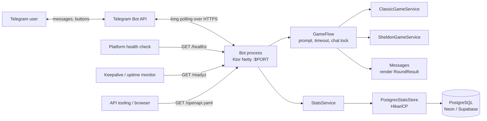
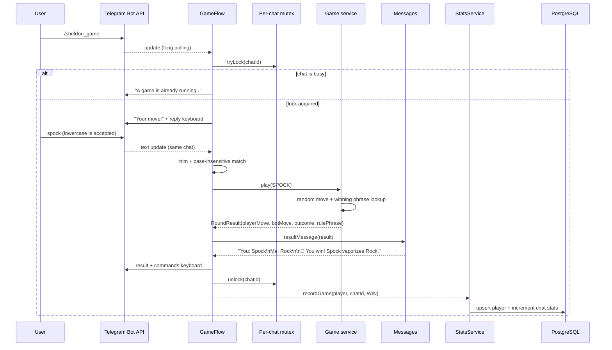

# Architecture

This document describes how the bot is put together, how a Telegram update travels
through the system, and where to extend it.

## Context



The bot is an outbound-only client of the Telegram Bot API. It does not expose a
webhook, so it can run behind NAT or on a PaaS without a public URL. It is deployed
to Render as a Docker web service; the Ktor server binds `0.0.0.0:$PORT` (Render
provides `PORT`, default 8080) and serves only `GET /healthz` (liveness),
`GET /readyz` (Telegram connectivity), and `GET /openapi.yaml` (the bundled API
description).

## Components

| Component | File | Responsibility |
| --- | --- | --- |
| Entry point | `src/main/kotlin/com/el_giancar/Application.kt` | Composition root: reads `AppConfig`, starts `embeddedServer(Netty)`, installs `/healthz`, `/readyz`, and `/openapi.yaml`, wires services, then runs the Telegram loop on the main thread. |
| Config | `src/main/kotlin/com/el_giancar/config/AppConfig.kt` | Reads `BOT_TOKEN`, `PORT`, and the optional `DATABASE_URL` / `DATABASE_USER` / `DATABASE_PASSWORD`; fails fast when the token is missing. |
| Telegram adapter | `src/main/kotlin/com/el_giancar/infrastructure/telegram/TelegramBot.kt` | Creates the bot, registers game/stats commands and the idle-text hint, runs long polling, records completed rounds, and refreshes readiness with a 60-second `getMe()` monitor. |
| Game flow | `src/main/kotlin/com/el_giancar/infrastructure/telegram/GameFlow.kt` | Acquires the per-chat lock, prompts for a move, applies the two-minute timeout, renders the result, and returns the completed `RoundResult` (or `null` when nothing was played). |
| Game I/O | `src/main/kotlin/com/el_giancar/infrastructure/telegram/GameIo.kt` | `GameIo` send/await seam plus the real `TelegramGameIo`, so the flow is testable without a bot. |
| Move parser | `src/main/kotlin/com/el_giancar/infrastructure/telegram/MoveParser.kt` | Maps trimmed, case-insensitive text to a legal move of the selected game. |
| Keyboards / messages | `src/main/kotlin/com/el_giancar/infrastructure/telegram/Keyboards.kt`, `Messages.kt`, `Replies.kt` | Reply keyboards, user-facing text, and shared reply helpers. |
| HTTP adapter | `src/main/kotlin/com/el_giancar/infrastructure/http/HealthRoutes.kt` | `GET /healthz` (always 200) and `GET /readyz` (200/503 from the readiness state). |
| OpenAPI adapter | `src/main/kotlin/com/el_giancar/infrastructure/http/OpenApiRoutes.kt` | `GET /openapi.yaml`; loads the bundled spec once and serves it as `application/yaml`. |
| Move domain | `src/main/kotlin/com/el_giancar/domain/Move.kt`, `ClassicMoveType.kt`, `SheldonMoveType.kt` | Legal moves, their display names, and the two variants. |
| Round domain | `src/main/kotlin/com/el_giancar/domain/GameOutcome.kt`, `RoundResult.kt` | Typed outcome (`WIN`/`LOSE`/`TIE`) and the resolved round data. |
| Stats domain | `src/main/kotlin/com/el_giancar/domain/Player.kt`, `PlayerStats.kt`, `LeaderboardEntry.kt`, `GameRecord.kt` | Player identity, per-chat/overall aggregates, ranked rows, and the completed-round record. |
| Stats application | `src/main/kotlin/com/el_giancar/application/StatsStore.kt`, `StatsService.kt` | Persistence boundary plus optional service that converts a missing/unreachable database into `Disabled`/`Unavailable` results. |
| Stats adapter | `src/main/kotlin/com/el_giancar/infrastructure/stats/PostgresStatsStore.kt` | HikariCP pool, idempotent schema creation, write upserts, personal queries, and global/chat leaderboards. |
| Player mapping | `src/main/kotlin/com/el_giancar/infrastructure/telegram/Players.kt` | Converts a Telegram `CommonUser` into a `Player`, including the display-name fallback. |
| Game application | `src/main/kotlin/com/el_giancar/application/Game.kt`, `GameRules.kt`, `GameService.kt` | Variant contract, legal moves + winning phrases, and shared round resolution. Stateless and Telegram-free. |
| Game variants | `src/main/kotlin/com/el_giancar/application/ClassicGameService.kt`, `SheldonGameService.kt` | The 3-move and 5-move rule sets; thin subclasses of `GameService`. |
| Chat locks | `src/main/kotlin/com/el_giancar/application/ChatLocks.kt` | Reference-counted per-chat `Mutex`; idle entries are evicted after release. Keeps the application layer Telegram-free. |
| Readiness | `src/main/kotlin/com/el_giancar/application/ReadinessState.kt` | Thread-safe connectivity flag shared by the Telegram adapter and `/readyz`. |
| Tests | `src/test/kotlin/com/el_giancar/{application,config}/*Test.kt`, `infrastructure/{http,telegram,logging,stats}/` | Exhaustive pair tables, canonical phrases, message formatting, move parsing, environment parsing, health/readiness/OpenAPI routes, log redaction, the idle-timeout filter, chat-lock eviction, the full `GameFlow` prompt loop through a fake `GameIo`, player labels, stats fallback behavior, H2-backed repository/leaderboard queries, and the idle-text hint rules. |
| Logging | `src/main/resources/logback.xml`, `infrastructure/logging/JulBridge.kt`, `ExpectedLongPollTimeoutFilter.kt` | Console appender at `info`, token redaction, a JUL-to-SLF4J bridge so tgbotapi logs use the same pattern, and a filter for the expected idle `getUpdates` timeout. |
| API spec | `src/main/resources/openapi/documentation.yaml` | Description of `/healthz`, `/readyz`, and `/openapi.yaml`; served by `OpenApiRoutes.kt`. |
| CI | `.github/workflows/ci.yml` | Runs ktlint, builds, and tests on push/PR. |
| Deploy | `.github/workflows/deploy-render.yml` | Updates `BOT_TOKEN` on Render and triggers a deploy. |

## Startup sequence

```mermaid
sequenceDiagram
    participant Main as main()
    participant Env as Environment
    participant Ktor as Ktor/Netty
    participant TG as runTelegramBot()
    participant API as Telegram Bot API

    Main->>Env: AppConfig.fromEnvironment() (fail fast if BOT_TOKEN is missing)
    Main->>Main: createStatsService() (optional Postgres pool + schema)
    Main->>Ktor: embeddedServer(..., port)
    Main->>Ktor: start(wait = false)
    Ktor->>Ktor: routing { GET /healthz, GET /readyz, GET /openapi.yaml }
    Main->>TG: runBlocking { runTelegramBot(token, games, locks, readiness, stats) }
    TG->>API: telegramBot(token), getMe()
    TG->>TG: readiness.markReady()
    TG->>API: buildBehaviourWithLongPolling (getUpdates loop)
    TG->>API: getMe() every 60s (readiness monitor)
    Note over TG,API: join() keeps the coroutine alive
    Note over Main,Ktor: finally -> readiness.markNotReady(); server.stop(...)
```

The HTTP server starts **before** the Telegram loop, so `/healthz`, `/readyz`, and
`/openapi.yaml` are reachable while the bot is starting. `/healthz` stays 200
regardless of Telegram; `/readyz` returns 503 until the first successful `getMe()`
and again if the periodic connection check fails. `runBlocking` keeps the main thread on the long-polling
task; if Telegram startup or polling fails, the exception propagates, the server is
stopped in `finally`, and the process exits non-zero. Ktor uses a `SupervisorJob`
for application children, which is why the bot is not launched as a fire-and-forget
child.

## Update flow



Key points:

- Command handlers are coroutines owned by tgbotapi's behaviour builder.
- `onCommand` runs the scenario in a subcontext filtered by `MessageFilterByChat`,
  so updates are already scoped to the originating chat. The game code adds an
  explicit `it.chat.id == message.chat.id` check as a second safety net.
- A `ConcurrentHashMap<Long, Mutex>` serializes games per chat. Different chats run
  independently.
- `GameFlow` wraps the prompt loop in `withTimeoutOrNull(2.minutes)`. A game that
  receives no move releases the lock and tells the user it timed out.
- Input is trimmed and matched case-insensitively against the moves' display names.
  Invalid input gets a hint and up to three tries; any command cancels the game.
- `GameFlow.play` returns the completed `RoundResult` only when a valid move was
  played. `TelegramBot` records that result through `StatsService` after the reply is
  sent; cancellations, timeouts, and invalid attempts return `null` and are not
  counted. A missing or failing database never changes the game outcome.
- An `onText` trigger replies with a short hint when an idle private chat sends plain
  text. It skips commands, chats where a game holds the lock, and group chats, because
  tgbotapi delivers each update to every trigger.

## Domain model

Every move implements `Move`, which supplies a human-readable `displayName`:

```kotlin
interface Move {
    val displayName: String
}

enum class ClassicMoveType(override val displayName: String) : Move {
    ROCK("Rock"), PAPER("Paper"), SCISSORS("Scissors")
}

enum class SheldonMoveType(override val displayName: String) : Move {
    ROCK("Rock"), PAPER("Paper"), SCISSORS("Scissors"),
    LIZARD("Lizard"), SPOCK("Spock")
}
```

A resolved round is data, not prose:

```kotlin
data class RoundResult<out M : Move>(
    val playerMove: M,
    val botMove: M,
    val outcome: GameOutcome,   // WIN, LOSE, TIE
    val rulePhrase: String?,    // e.g. "Rock crushes Scissors"; null for a tie
)
```

The Telegram layer parses text (case-insensitive, by `displayName`) into an enum
value; the services only accept enums. Reply buttons use `displayName`, so users see
`Rock` rather than `ROCK`.

### Winner resolution

`GameRules<M>` owns the legal moves and a `phrases` map keyed by `(winner, loser)`:

- `ClassicRules`: 3 pairs.
- `SheldonRules`: 10 pairs.

`GameService<M>` resolves a round by looking up `(player, bot)` and `(bot, player)`:

- equal moves → `TIE`, no phrase;
- `(player, bot)` present → `WIN` with that phrase;
- `(bot, player)` present → `LOSE` with that phrase;
- anything else → `error(...)`, which indicates a missing rule.

`ClassicGameService` and `SheldonGameService` only bind the generic service to their
rule set. Each service also exposes a deterministic `play(playerMove, botMove)`
overload. This keeps tests free of randomness. The random overload picks with
`java.util.Random` (injectable via the constructor).

### Score model

`GameRecord` carries the player, chat id, outcome, and timestamp of a finished
round. `StatsService` maps it to a `StatsStore` call and never throws database errors
into the game path:

```kotlin
sealed interface StatsResult<out T> {
    data object Disabled : StatsResult<Nothing>    // no DATABASE_URL
    data object Unavailable : StatsResult<Nothing> // configured, but unreachable
    data class Success<T>(val value: T) : StatsResult<T>
}
```

`PostgresStatsStore` stores one `players` row per Telegram user and one
`player_chat_stats` row per `(user_id, chat_id)`. Global totals and rankings are sums
across chats, so a player who plays in several groups appears once on the global
leaderboard. A win adds one point; ties and losses add zero. Leaderboard ranks use
competition ranking: equal points share a rank and the next distinct score skips the
occupied places.

## Error handling

- Missing `BOT_TOKEN` fails at startup with an actionable message.
- Unknown moves are re-prompted (max 3 attempts), then the game is cancelled cleanly.
- Sending a command while a game is pending cancels the game and releases the lock.
- A game with no move for two minutes times out, tells the user, and releases the lock.
- A second game in the same chat is rejected without disturbing the first.
- A missing `DATABASE_URL` disables scores. A database that fails at startup leaves
  scores disabled for that process; a database that fails later makes the stats
  commands report `Unavailable`. Neither case changes gameplay. Startup logs only the
  exception type, never the connection URL or credentials.
- Telegram/network failures still propagate to the handler coroutine; there is no
  retry/backoff layer.

## Deployment

The bot is deployed to **Render** as a Docker web service. GitHub Actions drives the
release: it pushes the current `BOT_TOKEN` secret to Render, then triggers a deploy.
Details and the one-time setup are in [`DEPLOYMENT.md`](DEPLOYMENT.md).

```mermaid
flowchart TB
    Dev[git push / v* tag / manual dispatch] --> GHA[GitHub Actions<br/>deploy-render.yml]
    GHA -->|PUT env-vars/BOT_TOKEN| RenderAPI[Render API]
    GHA -->|PUT env-vars/DATABASE_* (optional)| RenderAPI
    GHA -->|POST deploys| RenderAPI
    RenderAPI --> Render[Render Docker web service]
    Render --> Build[Build stage: gradle buildFatJar]
    Build --> Runtime[Runtime: java -jar /app/app.jar]
    Runtime --> Health[Ktor 0.0.0.0:$PORT<br/>GET /healthz + /readyz + /openapi.yaml]
    Runtime --> Poll[Telegram long polling]
    Runtime --> DB[(PostgreSQL<br/>optional)]
    Secret[GitHub secrets BOT_TOKEN + DATABASE_*] --> GHA
    Secret -.->|stored as env vars| Runtime
```

Notes:

- The Dockerfile copies `build/libs/*-all.jar` to a stable `/app/app.jar`, avoiding
  coupling to the project version in the file name.
- The token is injected at runtime as the Render environment variable `BOT_TOKEN`; it
  is never a build argument and is never baked into the image. Optional database
  credentials follow the same path and are only written when the corresponding GitHub
  secret is set.
- The bot creates the score schema on startup when `DATABASE_URL` is present. Without
  it, the service starts normally with score tracking disabled.
- CI (`.github/workflows/ci.yml`) lints, builds, and tests every push/PR. The deploy
  workflow (`.github/workflows/deploy-render.yml`) runs on `v*` tags or manual dispatch.
- Build and runtime both use JDK 21. Render supplies `PORT` and probes `/healthz`.
  The keepalive workflow probes `/readyz` so a disconnected bot is visible.
- The bot only needs a long-running process and outbound HTTPS to `api.telegram.org`;
  this architecture works on any comparable PaaS.

## Design decisions

- **Ktor with liveness and readiness routes.** `/healthz` keeps the process alive
  for PaaS checks without restarting it on a Telegram outage; `/readyz` reports the
  Telegram connection so monitors can tell a broken bot from a sleeping service.
- **Services separated from Telegram.** `application` has no tgbotapi dependency, which
  makes the rules unit-testable.
- **Typed service API.** Enums instead of strings remove an entire class of parsing
  bugs (case, unknown moves, wrong enum set).
- **Typed results, presentation in the adapter.** Services return `RoundResult`;
  `Messages.kt` turns it into text. Game rules stay free of wording and the bot can
  change its voice without touching the rules.
- **One shared round resolver.** `GameService` implements win/lose/tie once; the two
  variants only supply a rule set.
- **Long polling over webhooks.** Simpler ops, no TLS termination or public URL.
- **Optional remote scores.** Game state stays in memory; only completed rounds go to
  PostgreSQL. The store is keyed by Telegram user and chat, so global and per-chat
  views share one schema. A missing database is a supported mode, not a startup
  failure.

## Extension points

| Goal | Where to change |
| --- | --- |
| New command | `infrastructure/telegram/TelegramBot.kt` (`onCommand`) + `Keyboards.kt` + `Messages.kt` |
| New move | relevant `domain/*MoveType.kt` (enum + `displayName`), the variant's `phrases` map, `/rules`, tests, docs |
| Change the bot's wording | `infrastructure/telegram/Messages.kt` only |
| Change the game timeout | `GameFlow`'s `gameTimeout` parameter |
| Better randomness / tests | pass a seeded `Random` to the service constructor, or keep using the deterministic overload |
| Change score storage | implement `StatsStore` and wire it in `Application.createStatsService()`; keep SQL out of the game services |
| Change ranking rules | `PostgresStatsStore` queries and `withCompetitionRanks()`; update `LeaderboardEntry` docs and tests |
| Change the OpenAPI document | `src/main/resources/openapi/documentation.yaml`; the route picks it up automatically at startup |
| Webhook mode | Replace `buildBehaviourWithLongPolling` with the webhook builder and add a Ktor route |

## Non-goals

The current code does not aim to provide accounts, localization, rate limiting,
metrics, or horizontal scaling. Scores are deliberately minimal: no match history,
no per-move statistics, and no cross-device identity beyond the Telegram user id.
Any of these would require new infrastructure and should be designed explicitly.
